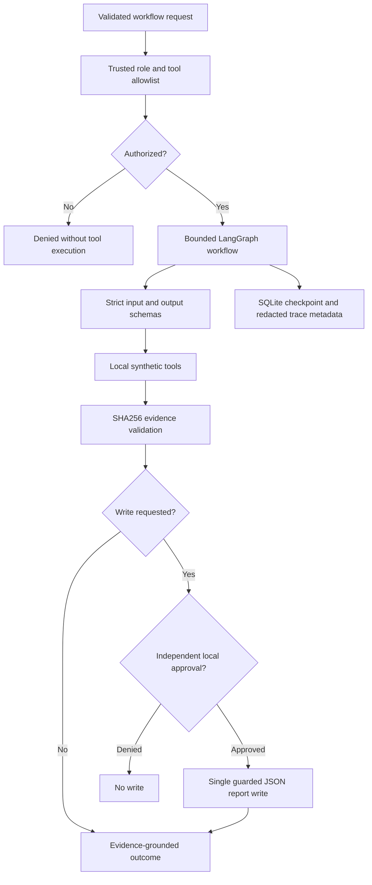

# Project 14 — Production Agentic AI & Tool-Orchestration Platform

[](#verified-results) [](#verified-results) [](LICENSE)

> **Scope:** A reproducible, **local and deterministic** LangGraph orchestration / safety demonstration for synthetic business-style analytics. The title expresses the engineering direction—not a claim of live production deployment, general LLM autonomy, or enterprise security certification.
>
> **Publication status:** Final local validation and screenshot evidence completed; GitHub Actions and public repository verification must be recorded **after** the first push.

## Problem and approach

Multi-step agent-style workflows need more than plausible final text. They need typed tool calls, authorization, bounded execution, grounded evidence, resumable state, approval before writes, observable outcomes, and failure testing. This project implements those controls for a **fixed set of synthetic local workflows**, without paid APIs or real accounts.



## Implemented features

| Capability | Implementation and boundary |
|---|---|
| Orchestration | Compiled LangGraph graph with deterministic task/step routing; validated local native fallback only for isolated tests. |
| Tool contracts | Pydantic input/output contracts, registry allowlist, pre-execution role checks, and rejection of unregistered tools. |
| Workflow classes | `metrics`, `retrieval`, `analysis`, and `report` using synthetic data; no arbitrary Python, shell, SQL, web, or external-account execution. |
| State and recovery | SQLite state checkpoints, duplicate request-ID rejection, pause/restart/resume; bounded read-only retries, no blind retry after uncertain writes. |
| Evidence | Validated tool outputs with canonical JSON SHA256 digests; fail-closed for missing, altered, or incomplete evidence. Hashes do **not** authenticate an attacker-writable store. |
| Human control | Report preview (`dry_run`), approval pause, local approver credentials distinct from execution credentials, explicit rejection and approval replay defense. |
| Observability | Stable trace IDs and redacted node/status/timing/count fields; real local step/scenario latency measurements; generated reports ignored by Git. |
| API demonstration | FastAPI endpoints for health, planning, authenticated workflow execution, state lookup, and approval. **Localhost-only** and not enterprise IAM. |
| Evaluation | Frozen deterministic development scenarios spanning success, authorization, hostile content, evidence failures, and retry/recovery behavior. |

### Example workflow outcomes

- **Metrics:** validate numerical input, calculate sample count/mean, verify evidence, and return a grounded result.
- **Analysis:** run metrics and synthetic document retrieval in sequence, verify both outputs, and produce an evidence-backed response.
- **Report preview:** execute read steps, return `dry_run`, and write nothing.
- **Approved report:** pause at `awaiting_approval`, require an independent local approval decision, verify evidence again, and write one guarded synthetic JSON report. Rejected approvals produce no report.

The original starter includes placeholders for broader SQL, RAG, forecasting, prediction, causal, graph ML and external adapters. These are **not** implemented live integrations in Project 14.

## Verified results

| Measurement | Final local Windows result | Interpretation |
|---|---:|---|
| Automated tests | **78 passed, 1 skipped** | Python 3.12, Windows. The skipped test requires symbolic-link creation privileges not available on the machine. |
| Frozen synthetic evaluation | **23/23 scenarios passed** | 5 positive, 14 safety, 4 recovery; exact expected/observed outcomes. |
| Mean workflow latency | **48.522 ms** | Local machine, 23 scenarios, measured in the final CP4 validation run. |
| P95 workflow latency | **86.054 ms** | Nearest-rank across the same 23 local scenarios; not a production SLA or cross-machine benchmark. |
| Tool attempts / recorded failures | **32 / 4** | Failures are deliberate synthetic fault cases (e.g. transient/persistent read and uncertain write); **not** 4 failed evaluation scenarios. |
| Paid LLM requests | **0** | No paid model tests; local CPU, engineering, network hosting and other costs excluded. |
| Prepublication audit | **Passed with manual review items** | Evaluation/trace reconciliation passed; code and generated outputs were checked locally. |

**Important:** Scenario fixtures and expected outcomes were frozen by SHA256, but these are **visible development regression scenarios, not held-out or representative real-world production cases**. In particular, 14/14 local safety scenarios is not proof of general resistance to prompt injection. The originally named `retried_tools` count was corrected to `failed_tool_attempts`; an uncertain write is not retried automatically.

See [evaluation methodology](docs/CP3_EVALUATION.md), [CP4 audit scope](docs/CP4_PREPUBLICATION_AUDIT.md), and the source scenarios in [`data/evaluation/cp3_scenarios.json`](data/evaluation/cp3_scenarios.json).

## Reproduce locally

Requires Python **3.12** and PowerShell (shown below); the project uses a dedicated virtual environment.

```powershell
py -3.12 -m venv .venv
.\.venv\Scripts\python.exe -m pip install -r requirements-cp2.txt
.\.venv\Scripts\python.exe scripts\validate_cp4.py
```

The validator reruns pytest, requires a **compiled LangGraph** for the acceptance evaluation, executes the frozen synthetic scenarios, and writes ignored local artifacts:

- `outputs/cp3_evaluation_report.json`
- `outputs/cp3_redacted_traces.jsonl`
- `outputs/cp4_prepublication_audit.json`

Run only the frozen evaluation and inspect scenario details with:

```powershell
.\.venv\Scripts\python.exe scripts\validate_cp3.py
.\.venv\Scripts\python.exe scripts\cp4_evidence.py approval
.\.venv\Scripts\python.exe scripts\cp4_evidence.py safety
.\.venv\Scripts\python.exe scripts\cp4_evidence.py recovery
.\.venv\Scripts\python.exe scripts\cp4_evidence.py traces
```

The larger `requirements.txt` reflects potential future adapters; **`requirements-cp2.txt` is the tested local/CI baseline**. Its dependencies use bounded ranges rather than a full reproducible lockfile. The `.github/workflows/ci.yml` workflow is configured for Python 3.12 on Windows and Ubuntu. **Do not claim remote CI passed until a real GitHub Actions run has completed.**

### Optional local API

The API code is in `src/agentic_ai/api/main.py`. Workflow endpoints fail closed unless local execution/approver tokens are set via the **process environment**. Do not store or publish tokens. Start only on loopback:

```powershell
$env:PYTHONPATH = 'src'
.\.venv\Scripts\python.exe -m uvicorn agentic_ai.api.main:app --host 127.0.0.1 --port 8000
```

Available endpoints include `GET /health`, `POST /plan`, `POST /workflows`, `GET /workflows/{request_id}`, and `POST /workflows/{request_id}/approval`. See [CP2 execution and safety design](docs/CP2_ORCHESTRATION.md) for authentication behavior and workflow rules. Do **not** expose this demonstration service to the internet.

## Screenshot evidence

All eight numbered screenshots were captured from **actual local PowerShell runs** before publication. Screenshots do not represent a cloud deployment or a GitHub CI run.

| Screenshot | Evidence |
|---|---|
| [01 — Full validation](screenshots/01_cp4_full_validation.png) | 78 passed, 1 skipped and CP4 validation output. |
| [02 — Frozen evaluation](screenshots/02_cp3_frozen_evaluation.png) | 23/23 development scenarios, source hash and measured local latency. |
| [03 — Approval and rejection](screenshots/03_approval_and_rejection.png) | Dry-run, approved/rejected report behavior and replay rejection. |
| [04 — Unsafe action denials](screenshots/04_unsafe_action_denials.png) | Roles, unknown tools, invalid inputs, unsafe source and injected-content cases. |
| [05 — Recovery](screenshots/05_retry_resume_and_uncertain_write.png) | Duplicate IDs, restart-resume, read retries and uncertain-write handling. |
| [06 — Trace evidence](screenshots/06_evidence_trace_ids.png) | Actual redacted trace IDs and step sequences. |
| [07 — Local security audit](screenshots/07_cp4_security_dependency_audit.png) | Prepublication file/trace/dependency checks and manual-review warnings. |
| [08 — Git preflight](screenshots/08_prepublication_git_review.png) | Git initialization, `.env` ignore behavior and local prepublication audit. |

A companion 9-page Word evidence handoff was prepared **outside the Git repository** with all eight screenshots, filenames, and descriptions. Its existence is not equivalent to an independent production audit.

## Security, privacy, and limitations

- **No real or confidential employer/customer data.** Synthetic corpus and metrics only.
- No live OpenAI calls, paid LLM experiments, AWS deployment, production endpoints, external writes, or enterprise accounts.
- No unrestricted code execution, external SQL, browser automation, network tool access or general autonomous planning.
- Agent execution is bounded but **does not impose a hard wall-clock timeout per tool**.
- SQLite checkpoint and SHA256 integrity checks do not provide tamper-proof, signed, or remotely authenticated audit logs.
- No enterprise SSO, distributed locking, robust rate limiting, secure multi-tenant controls, or production load testing.
- Windows symbolic-link regression was skipped when OS privileges prevented creating the fixture; that machine did **not** exercise the symlink defense.
- A prior starter archive exposed a populated API credential. The owner reports it was revoked/rotated. Neither the `.env` file nor its contents are included in the repository; ignore rules exclude local environment variants. `.env.example` contains only a placeholder. Credential revocation was **not independently verified** by the tests.
- Before any publication, run `scripts/check_git_publication.py` and inspect staged filenames and changes. Pattern scanning reduces accidental exposure risk but is **not a comprehensive secret audit**.

## Project structure

```text
14_production_agentic_ai/
├── .github/workflows/ci.yml       # Proposed two-OS test CI
├── data/evaluation/               # Frozen synthetic evaluation contract
├── data/fixtures/                 # Synthetic documents and metrics
├── docs/                          # Workflow, evidence and audit design
├── screenshots/                   # Eight real local verification PNGs
├── scripts/                       # Local validation, audit, publication checks
├── src/agentic_ai/                # Contracts, workflow, tools, state, API, eval
├── tests/                         # Unit and regression tests
├── LICENSE                        # MIT
├── requirements-cp2.txt           # Tested evaluation/runtime dependencies
└── README.md
```

## License and publication

MIT License — see [LICENSE](LICENSE). Dependency metadata was inventoried during CP4, but full third-party provenance and redistribution review is not established by automated tests. This project is an educational portfolio demonstration, not a security-certified production service.
